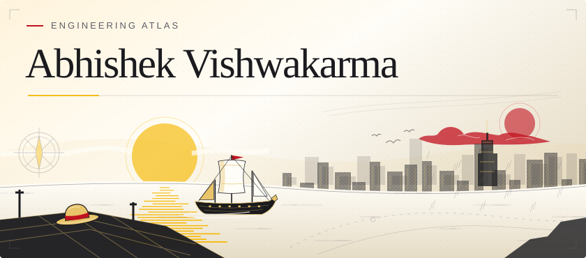
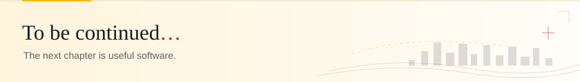

<!-- A personal Engineering Atlas for avrulesyou. -->

<picture>
  <source media="(prefers-color-scheme: dark)" srcset="assets/banner-dark.svg">
  
</picture>

<picture>
  <source media="(prefers-color-scheme: dark)" srcset="assets/caption-dark.svg">
  
</picture>

**Full-stack developer · AI and data builder · blockchain and product engineering**

I turn ambitious ideas into useful software: from anomaly detection and machine
learning notebooks to Solana applications, cross-platform mobile tools, and
full-stack web products.

**Current focus:** learning at the edge of applied AI, data engineering, and
trustworthy decentralized systems while completing graduate computer science work.

[Explore my contribution atlas](https://avrulesyou.github.io/avrulesyou/) ·
[What I build](#what-i-build) · [Toolkit](#toolkit) ·
[Play The Ember Forge](#the-ember-forge)

<a href="https://avrulesyou.github.io/avrulesyou/">
  <picture>
    <source media="(prefers-color-scheme: dark)" srcset="https://raw.githubusercontent.com/avrulesyou/avrulesyou/output/battlefield-dark.svg">
    
  </picture>
</a>

Each tower is a day. Height reflects contribution count and color reflects
intensity, not a repository or project category. The interactive page includes
the daily record, filters, streaks, weekday patterns, and a downloadable card.

<picture>
  <source media="(prefers-color-scheme: dark)" srcset="https://raw.githubusercontent.com/avrulesyou/avrulesyou/output/snake-dark.svg">
  
</picture>

**The numbers, with context.** The atlas uses aggregate GitHub contribution
data only. It never requests repository names or private code.

## What I build

### Applied AI and data
Machine learning experiments, anomaly detection, regression analysis, computer
vision, and practical Python workflows that turn data into decisions.

### Blockchain and decentralized products
Solana and Web3 experiments, trust-minimized workflows, token-aware products,
and applications that connect real-world activity to verifiable data.

### Full-stack and mobile systems
TypeScript and JavaScript products, Python services, React interfaces, Flutter
and .NET MAUI applications, dashboards, APIs, and developer tooling.

## Collectibles

<table>
  <tr>
    <td width="50%" valign="top">
      <picture>
        <source media="(prefers-color-scheme: dark)" srcset="https://raw.githubusercontent.com/avrulesyou/avrulesyou/output/wanted-dark.svg">
        
      </picture>
    </td>
    <td width="50%" valign="top">
      <picture>
        <source media="(prefers-color-scheme: dark)" srcset="https://raw.githubusercontent.com/avrulesyou/avrulesyou/output/bingo-dark.svg">
        
      </picture>
    </td>
  </tr>
</table>

Playful editions of the same contribution snapshot, not additional work claims.

## Toolkit

<table>
  <tr>
    <th width="33%">First track Languages &amp; UI</th>
    <th width="33%">Second track Data &amp; platforms</th>
    <th width="34%">Third track Emerging systems</th>
  </tr>
  <tr>
    <td align="center" valign="top">
      
    </td>
    <td align="center" valign="top">
      
    </td>
    <td align="center" valign="top">
      
      
    </td>
  </tr>
</table>

**Languages & UI:** Python · TypeScript · JavaScript · React · Flutter · C# · Rust ·
**Data & platforms:** Jupyter · .NET · Node.js · Django · Docker · GitHub Actions ·
**Emerging systems:** Solana · Ethereum · machine learning · computer vision

## Selected work

<table>
<tr>
<td width="50%" valign="top">

### [SightLine](https://github.com/avrulesyou/SightLine)

A DePIN task network for collecting verifiable real-world data with a
trustless public-on-reject mechanism on Solana Seeker.

- React Native and Expo
- Solana wallet and escrow flows
- Camera, audio, and geolocation proofs

</td>
<td width="50%" valign="top">

### [Fraud detection with PyOD](https://github.com/avrulesyou/assignment4-unsupervised_deep_learning)

An unsupervised learning experiment that uses an AutoEncoder to detect
anomalous credit-card transactions from reconstruction error.

- Python and PyOD
- AutoEncoder-based anomaly detection
- Evaluation-oriented data workflow

</td>
</tr>
<tr>
<td width="50%" valign="top">

### [Location Heatmap Tracker](https://github.com/avrulesyou/location-tracker)

A cross-platform .NET MAUI application for tracking location and visualizing
movement as a real-time heatmap.

- .NET MAUI and C#
- Local SQLite persistence
- Android, iOS, Windows, and macOS targets

</td>
<td width="50%" valign="top">

### [Python Q&amp;A Chatbot](https://github.com/avrulesyou/chatbot)

A hands-on conversational assistant built to explore practical Python,
Django, and ChatterBot workflows.

- Python and Django
- Terminal-first interaction
- Structured conversational flows

</td>
</tr>
</table>

## GitHub activity

## The Ember Forge

I made a tiny browser game for the profile: guide a dragon through a living
cave, gather embers, and keep the story alive.

 
Playable on desktop and mobile · no sign-in · no tracking

## The route so far

**2016–now** software engineering, AI learning, data experiments, blockchain,
and product building

About this atlas

The artwork is original SVG, inspired by visual storytelling and field
cartography. The data-driven images are generated with dependency-free Python
from aggregate GitHub calendar data. The explorer is designed for GitHub Pages.

<picture>
  <source media="(prefers-color-scheme: dark)" srcset="assets/footer-dark.svg">
  
</picture>

## Connect

